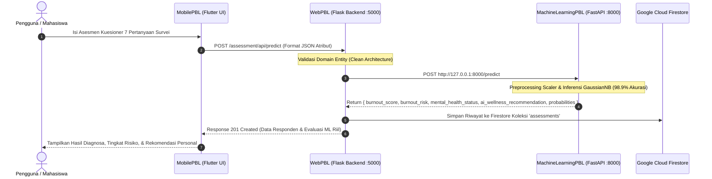

# 🛡️ AntiBurnout: Sistem Deteksi Dini & Manajemen Risiko Burnout Berbasis Machine Learning

> Proyek Terpadu **Project-Based Learning (PBL)** untuk deteksi dini, evaluasi psikometrik, dan rekomendasi personal penanganan kejenuhan belajar/kerja (*burnout*) bagi mahasiswa dan profesional muda melalui integrasi **Machine Learning Microservice**, **Web Backend & Admin Portal**, serta **Cross-Platform Mobile App**.

---

## 👥 Tim Pengembang (Kelompok 4 | TI-3H)
- **Muhammad Anka Reza** (10)
- **Esatovin Ebenhaezer Victoria** (05)
- **Louis Judia B Sinaga** (09)
- **Raditya Zandra Fadhillah** (19)
- **Sandy Kurniawan** (24)

---

## 🏗️ Arsitektur Ekosistem Monorepo

Proyek ini dibangun dengan pendekatan modular yang saling terhubung secara mulus:

```text
AntiBurnout/
├── 🧠 MachineLearningPBL/   # Modul Riset & Microservice ML
│   ├── api/                 # 🚀 Folder Khusus Microservice API (FastAPI - Port 8000)
│   │   ├── models/          # Serialisasi Model Jawara (best_model.pkl & scaler.pkl)
│   │   ├── app.py           # REST API Endpoint (/predict, /models, /health, /docs)
│   │   ├── run.py           # Server Runner Uvicorn
│   │   └── requirements.txt # Dependensi Microservice
│   ├── run_ml.bat           # Launcher Satu Klik di Windows
│   └── PBL_Perbandingan_Model_Terbaik.ipynb # Riset & Grand Comparison
│
├── 🌐 WebPBL/               # Backend Web & Data Entry Admin Portal (Flask - Port 5000)
│   ├── app/                 # Clean Architecture (Core Domain, Use Cases, Infrastructure)
│   ├── run.py               # Server Runner Backend Flask
│   └── data/                # SQLite Local Fallback Engine & Skema SQL
│
├── 📱 MobilePBL/            # Aplikasi Mobile & Web Interaktif Pengguna (Flutter)
│   └── mobile/              # Flutter App (Riverpod, Material 3, Clean Architecture)
│       └── lib/             # Fitur: Auth, Survey Stepper, Dashboard, Rekomendasi
│
└── 📊 dataset/              # Dataset Referensi Penelitian (50,000 Baris & 40 Atribut)
    └── mental_health_burnout_prediction_dataset.csv
```

---

## 🏆 Hasil Grand Comparison Model Machine Learning

Berdasarkan analisis komparatif mendalam pada notebook [`PBL_Perbandingan_Model_Terbaik.ipynb`](./MachineLearningPBL/PBL_Perbandingan_Model_Terbaik.ipynb) terhadap 5 keluarga algoritma *Supervised Learning*:

| Peringkat | Algoritma & Konfigurasi | Akurasi Data Uji | F1-Score Macro | 5-Fold CV Mean | Status Deployment |
|:---:|:---|:---:|:---:|:---:|:---:|
| 🥇 **1** | **Naive Bayes (GaussianNB)** | **98.90%** | **0.9850** | **98.60% (±0.21%)** | **Champion Model (Aktif di API)** |
| 🥈 2 | **Logistic Regression (L1 / Lasso)** | 98.90% | 0.9850 | 98.53% (±0.44%) | Model Alternatif 1 |
| 🥉 3 | **Support Vector Machine (Kernel RBF)** | 98.90% | 0.9850 | 98.60% (±0.50%) | Model Alternatif 2 |
| 4 | **Random Forest (Kriteria GINI)** | 80.40% - 98.90% | 0.7854 - 0.9850 | 80.92% (±1.10%) | Model Alternatif 3 |
| 5 | **K-Nearest Neighbors (Manhattan)** | 89.80% | 0.8820 | 88.78% (±0.78%) | Evaluasi Pembanding |

### Mengapa Naive Bayes Gaussian Terpilih sebagai Champion API?
1. **Akurasi & Presisi Puncak**: Mencapai akurasi **98.90%** dan F1-Macro **0.9850** (Presisi Low: 1.0000, Moderate: 1.0000, High: 0.9481).
2. **Latensi Inferensi Ultra-Cepat**: Waktu komputasi inferensi **< 0.2 milidetik** per request, sangat hemat daya komputasi dan mampu melayani ratusan request mahasiswa serentak tanpa lag.
3. **Ukuran Model Super Ringan**: Bobot model serialisasi (`best_model.pkl`) hanya **2.3 KB**, sangat ramah deployment pada server lokal maupun cloud serverless.

---

## 🔄 Diagram Alur Integrasi End-to-End



---

## 🚀 Panduan Menjalankan Sistem (Quick Start)

Untuk menjalankan seluruh ekosistem aplikasi secara terintegrasi:

### Langkah 1: Jalankan Machine Learning Microservice API (Port 8000)
- **Cara Termudah**: Klik ganda file [MachineLearningPBL/run_ml.bat](./MachineLearningPBL/run_ml.bat)
- **Atau via Terminal**:
  ```cmd
  cd c:\laragon\www\AntiBurnout\MachineLearningPBL\api
  C:\laragon\bin\python\python-3.10\python.exe run.py
  ```
  - *Base URL*: `http://127.0.0.1:8000`
  - *Swagger UI Interaktif*: `http://127.0.0.1:8000/docs`
  - *ReDoc Documentation*: `http://127.0.0.1:8000/redoc`

### Langkah 2: Jalankan Web Backend & Admin Portal (Port 5000)
Buka terminal baru:
```cmd
cd c:\laragon\www\AntiBurnout\WebPBL
C:\laragon\bin\python\python-3.10\python.exe run.py
```
- *Web Portal*: `http://127.0.0.1:5000`
- *Login Administrator Default*: `admin` / `admin123`
- *Endpoint API Publik Mobile*: `http://127.0.0.1:5000/assessment/api/predict`

### Langkah 3: Jalankan Aplikasi Mobile (Flutter)
Buka terminal baru:
```cmd
cd c:\laragon\www\AntiBurnout\MobilePBL\mobile
flutter run -d chrome
# atau flutter run -d <id_perangkat_android/ios>
```
> [!TIP]
> **Autentikasi Google & Firebase**:
> - Di **Web / Chrome**, login Google langsung aktif tanpa perlu SHA-1 (cukup aktifkan provider Google di Firebase Console).
> - Di **Android (Device/Emulator)**, pastikan fingerprint SHA-1 & SHA-256 lokal sudah didaftarkan di Firebase Console. Panduan lengkap dan kode SHA-1 tersedia di [MobilePBL/mobile/README.md](./MobilePBL/mobile/README.md#konfigurasi-firebase-authentication--google-sign-in).

---

## 🔌 Kontrak & Spesifikasi Endpoint API

### 1. Endpoint Prediksi ML Langsung (`POST http://127.0.0.1:8000/predict`)
- **Query Parameter (Opsional)**: `?model_choice=champion` (pilihan: `champion`, `logistic_regression`, `random_forest`)
- **Payload Request (Mendukung Input Lengkap / Ringkas)**:
  ```json
  {
    "full_name": "Rizky Mahasiswa",
    "sleep_quality": "Poor",
    "sleep_hours": 4.5,
    "screen_time_hours": 10.0,
    "coffee_cups_per_day": 4,
    "stress_level": "High",
    "meditation_minutes": 5.0,
    "mood_score": 30.0,
    "work_hours_per_week": 55.0,
    "chronic_stress": "Yes"
  }
  ```
- **Response JSON**:
  ```json
  {
    "status": "success",
    "is_simulation": false,
    "model_name": "Gaussian Naive Bayes (GaussianNB)",
    "burnout_score": 98.0,
    "burnout_risk": "High",
    "burnout_level": "High (Gaussian Naive Bayes (GaussianNB))",
    "mental_health_status": "Critical",
    "ai_wellness_recommendation": "Tingkat risiko burnout tinggi terdeteksi oleh AI. Segera kurangi jam kerja/belajar, ambil jeda pemulihan, dan jadwalkan sesi konseling dengan profesional.",
    "badge_class": "danger",
    "probabilities": {
      "low": 0.0,
      "moderate": 0.0001,
      "high": 0.9999
    }
  }
  ```

### 2. Endpoint Gateway WebPBL (`POST http://127.0.0.1:5000/assessment/api/predict`)
Endpoint ini digunakan langsung oleh **MobilePBL**. WebPBL memproses validasi domain entity, meneruskan ke ML API, menyimpannya ke **Google Cloud Firestore**, dan mengembalikan status `201 Created` beserta entity ID.

---

## 🛡️ Keamanan & Penanganan Fallback (Fault Tolerance)
1. **Fallback Heuristik**: Jika microservice ML di port 8000 offline atau dalam pemeliharaan, WebPBL dan MobilePBL secara otomatis mengaktifkan *heuristic correlation fallback* berbasis formula psikometrik dataset, memastikan aplikasi tidak pernah crash bagi pengguna.
2. **Dual-Engine Database**: WebPBL mendukung Google Cloud Firestore secara otomatis, dengan fallback ke SQLite lokal (`data/antiburnout.db`) jika koneksi internet terputus.
3. **CORS & Platform-Safe**: WebPBL dan MachineLearningPBL mendukung preflight CORS (`OPTIONS`, `Access-Control-Allow-Origin: *`) dan MobilePBL menggunakan platform-safe HTTP dispatching yang kompatibel di Android, iOS, maupun Flutter Web.

---

## 📜 Lisensi & Hak Cipta
Dikembangkan untuk keperluan akademik Project-Based Learning (PBL) Program Studi Teknik Informatika, Politeknik Negeri Malang (POLINEMA).
